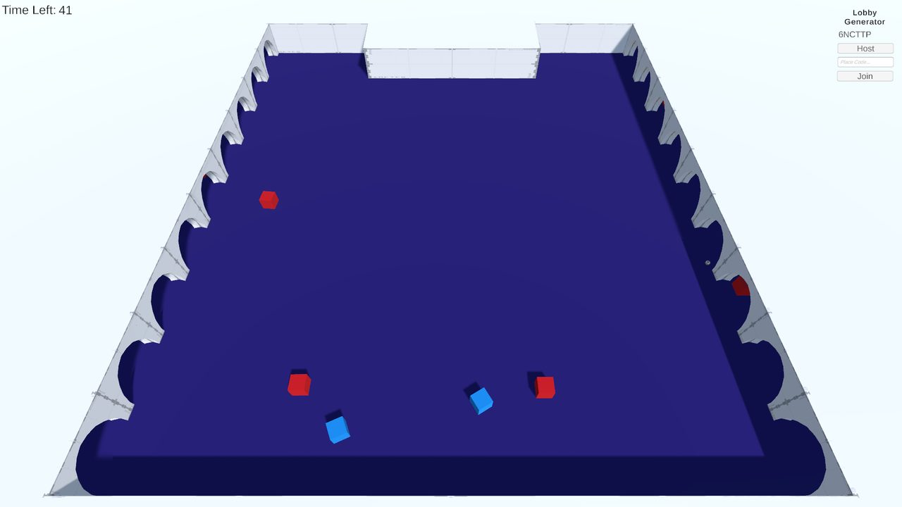
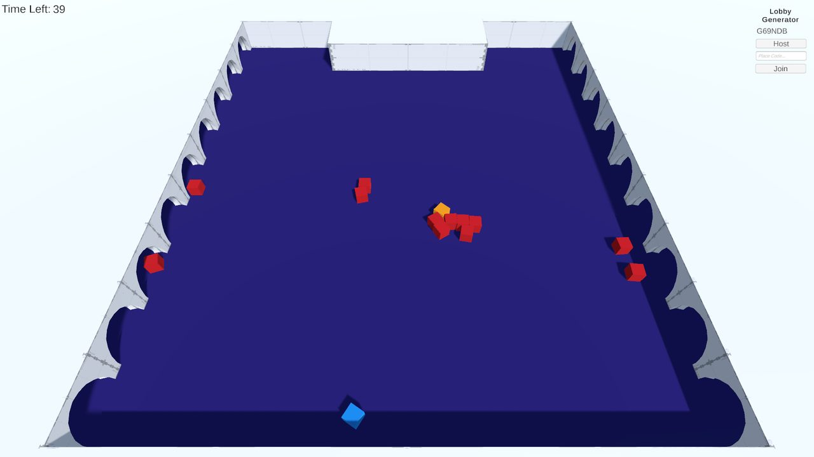
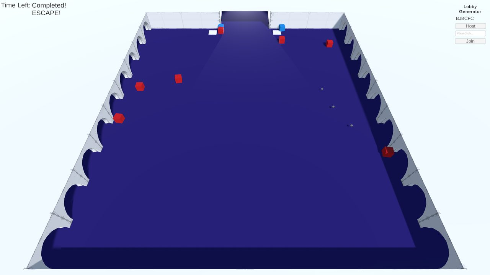

# TFG Prototype 1 · Communication and immediate coordination

Online 2-player co-op prototype built in **Unity (C#) with Netcode for GameObjects and Unity Relay**.
It is the first of three prototypes from my Final Degree Project at Universitat Pompeu Fabra (2024–2025, grade 9/10):

> _Análisis de los mecanismos en videojuegos multijugador y su impacto en la tipología de cooperación_
> (Analysis of mechanics in multiplayer video games and their impact on the type of cooperation)

The thesis analyses 44 small-scale co-op games, defines three types of cooperation (**communication**,
**planning** and **coordination**) and the mechanics that encourage each one, and validates them with
three playable prototypes and a user study with 20 participants (10 pairs).

## What this prototype tests

Focus: **communication** under pressure, plus **coordination** in critical moments.

- Two identical characters in a small arena, so players have to split roles on their own.
- Waves of enemies come at them during a time limit, with an isometric camera so both players always see each other.
- Enemies can knock a player down; the teammate can revive them. If both are down, the run is over.
- When time runs out, both players must stand on two pressure plates **at the same time** to open the door and escape.

| Downed player waiting to be revived | Time's up: escape through the door |
| --- | --- |
|  |  |

## Controls

| Action | Input |
| --- | --- |
| Move | WASD / arrow keys |
| Sprint | Left Shift |
| Jump | Space |
| Shoot | Left mouse button (Fire1) |

## Running it

1. Open the project with **Unity 2022.3.29f1**.
2. Link it to your own Unity Gaming Services project (Edit → Project Settings → Services) and enable **Relay**: the original project ID belongs to my account.
3. Open the `Game1` scene and press Play. One player hosts and gets a **join code**; the other enters it to join.
4. To test both players on one machine, the project includes **ParrelSync** to open a clone of the editor.

## The other prototypes

- [Prototype 2 · Planning and cooperation with the environment](https://github.com/Catcrac/TFG_Prototype_2)
- [Prototype 3 · Synergy and complex strategy](https://github.com/Catcrac/TFG_Prototype_3)

## License

[MIT](LICENSE)
